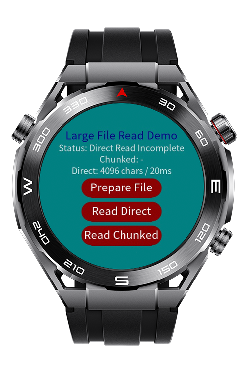

> **Note:** To access all shared projects, get information about environment setup, and view other guides, please visit [Explore-In-HMOS Index](https://github.com/Explore-In-HMOS/hmos-index).

# How To Read Large Text Files ?

By default, file.readText reads up to 4096 bytes if the length parameter is not specified. Therefore, large text files may not be read completely in a single read operation. This demo shows how to overcome this limitation by reading the file in chunks using the length and position parameters.

# Preview

<p>
  
  
</p>

# Use Cases

- Reading large JSON configuration files
- Loading plans or programs on depends on application features - stored as text
- Reading cached data from local file storage
- Saving Wear Engine data to file and read it
- Processing text files larger than the default 4096-byte read size

# Tech Stack

- **Languages**: JS
- **Frameworks**: HarmonyOS SDK 5.1.0(18) 
- **Tools**: DevEco Studio Vers 6.1.1(24)

# Directory Structure

```
entry/src/main/js/MainAbility
│
├── pages/
│   ├── index.css
│   ├── index.hml
│   └── index.js
│
├── FileService.js
│
├── i18n/
│   ├── en-US.json
│   └── zh-CN.json
│
└── app.js
```

# Constraints and Restrictions

## Supported Devices

- Huawei Sport (Lite) Watch GT 4/5/6
- Huawei Sport (Lite) GT5/6 Pro 
- Huawei Sport (Lite) Fit 3/4 
- Huawei Sport (Lite) D2 
- Huawei Sport (Lite) Ultimate

# LICENSE
**How To Read Large Text Files ?** is distributed under the terms of the MIT License.
See the [LICENSE](/LICENSE) for more information.
